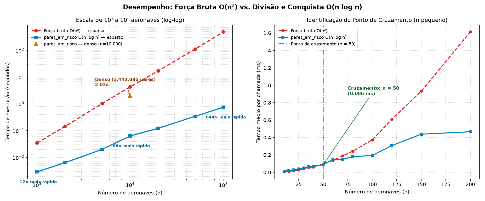

# Detector de Conflitos de Separação em Espaço Aéreo

Projeto da disciplina de **Projeto e Análise de Algoritmos (PAA)** — Engenharia de Software, Universidade de Brasília (UnB). Implementa o algoritmo de **Par de Pontos Mais Próximos** por divisão e conquista em $O(n \log n)$ e uma variação sensível à saída que lista **todos** os pares de aeronaves abaixo de uma distância mínima de segurança, aplicados a um cenário de gerenciamento de tráfego aéreo em um plano 2D.

---

## Objetivo

1. Implementar corretamente o algoritmo clássico do **Par de Pontos Mais Próximos** por divisão e conquista em $O(n \log n)$.
2. Adaptar o algoritmo (`pares_em_risco`) para detectar **todos** os pares em violação de separação horizontal (`distância < d_seguro`), e não apenas o par mais próximo.
3. Comparar empiricamente a divisão e conquista com a força bruta ($O(n^2)$) de $10^3$ a $10^5$ aeronaves, identificando o **ponto de cruzamento** a partir do qual a divisão e conquista passa a compensar.
4. Medir o efeito da **densidade de aeronaves** no custo da variação que coleta todos os pares em conflito.
5. Disponibilizar uma simulação em múltiplos frames com registro em log (`saida/log.txt`) e visualização interativa autossuficiente em HTML/SVG (`saida/relatorio.html`).

---

## O problema

Dado um conjunto de $n$ aeronaves no espaço aéreo, cada uma representada por sua posição horizontal $(x, y)$ em **milhas náuticas (NM)** em um instante de tempo, deseja-se identificar:

1. Qual é o par de aeronaves mais próximo entre si; e
2. Quais pares estão a **menos de `d_seguro = 5 NM`** um do outro (referência padrão de separação horizontal mínima em radar de rota/aproximação).

Testar todos os $\binom{n}{2} = \frac{n(n-1)}{2}$ pares por força bruta exige tempo $\Theta(n^2)$, tornando-se lento à medida que $n$ cresce para milhares de aeronaves. A abordagem de **divisão e conquista** explora a geometria do plano para descartar comparações entre pontos distantes da linha divisória, reduzindo o custo para $O(n \log n)$ em cenários com densidade normal de tráfego.

---

## Algoritmos e Recorrência

### 1. `par_mais_proximo(pontos)` (`par_mais_proximo.py`)

Divisão e conquista clássica:

1. **Pré-ordenação:** ordena os pontos por coordenada $x$ uma única vez em $O(n \log n)$.
2. **Divisão e recursão:** divide o vetor ao meio pela mediana em $x$ (`x_divisoria`) e resolve recursivamente as metades esquerda e direita. Cada chamada recursiva também devolve os pontos ordenados por $y$ via intercalação (*merge*) linear, evitando reordenar a cada nível.
3. **Combinação na faixa (*strip*):** seja $d = \min(d_{\text{esq}}, d_{\text{dir}})$. Apenas pontos cuja distância horizontal até `x_divisoria` é estritamente menor que $d$ podem formar um par com distância menor que $d$ entre as metades. Percorrendo a faixa ordenada por $y$, cada ponto é comparado somente com os seguintes enquanto $\Delta y < d$ (pelo argumento de empacotamento geométrico em caixas de lado $d/2$, há **no máximo 7 comparações** por ponto).
4. **Retorno:** devolve `(menor_distancia, (i, j))` com `i < j`.

**Recorrência do passo recursivo:**

$$T(n) = 2T\left(\frac{n}{2}\right) + \Theta(n)$$

Pelo Teorema Mestre ($a = 2, b = 2, f(n) = \Theta(n) = \Theta(n^{\log_b a})$), obtém-se:

$$T(n) = \Theta(n \log n)$$

Somada à ordenação inicial por $x$ em $\Theta(n \log n)$, a complexidade total é **$\Theta(n \log n)$** em tempo e $\Theta(n)$ em espaço auxiliar.

---

### 2. `pares_em_risco(pontos, d_seguro)` (`pares_em_risco.py`)

Variação de `par_mais_proximo` para enumerar **todos** os pares com distância estritamente menor que `d_seguro`:

- Em vez de encolher a largura da faixa conforme encontra distâncias menores, a faixa em torno de `x_divisoria` mantém **largura fixa `d_seguro`** em todos os níveis da recursão: $|x - x_{\text{divisoria}}| < d_{\text{seguro}}$.
- Pares inteiramente contidos na metade esquerda ou na metade direita já foram registrados pelas respectivas chamadas recursivas. Por isso, na etapa de combinação são registrados **apenas pares que cruzam a divisória** (um ponto à esquerda e outro à direita), garantindo que cada par em conflito seja reportado **exatamente uma vez**.

**Recorrência e sensibilidade à densidade:**

$$T(n) = 2T\left(\frac{n}{2}\right) + O(n + c_{\text{faixa}})$$

onde $c_{\text{faixa}}$ é o número de pares inspecionados dentro da faixa de largura $2 \cdot d_{\text{seguro}}$ com $\Delta y < d_{\text{seguro}}$:

- **Cenário esparso** (densidade espacial limitada, poucos conflitos $k \ll n^2$): cada ponto na faixa tem número constante esperado de vizinhos a menos de $d_{\text{seguro}}$, logo $c_{\text{faixa}} = O(n)$ e o custo total permanece **$O(n \log n + k) = O(n \log n)$**.
- **Cenário de alta densidade** (muitas aeronaves concentradas em área pequena): grande parte dos pontos cai dentro da faixa e possui $\Delta y < d_{\text{seguro}}$, fazendo o número de pares em risco $k$ e de comparações crescerem em direção ao limite superior **$O(n^2)$**.

---

### 3. `forca_bruta(pontos, d_seguro)` (`forca_bruta.py`)

Compara todos os $\binom{n}{2}$ pares em **$\Theta(n^2)$**. É usada como oráculo de referência nos testes automatizados e como linha de base no benchmark. O módulo também inclui `par_mais_proximo_forca_bruta(pontos)`.

---

### Convenções da API

- `pontos` é uma sequência de tuplas `(x, y)` em NM.
- Os pares são devolvidos pelos **índices** `(i, j)` na sequência original, sempre com `i < j`.
- `par_mais_proximo(pontos)` devolve `(distancia, (i, j))` e levanta `ValueError` se `len(pontos) < 2`.
- `pares_em_risco(pontos, d_seguro)` e `forca_bruta(pontos, d_seguro)` devolvem uma lista de `(i, j, distancia)` ordenada por `(i, j)`.
- A condição de conflito é **estrita** (`distancia < d_seguro`). Se `d_seguro <= 0` ou `len(pontos) < 2`, o retorno é `[]`.

```python
from par_mais_proximo import par_mais_proximo
from pares_em_risco import pares_em_risco

aeronaves = [(0, 0), (3, 4), (20, 20), (21, 20)]

par_mais_proximo(aeronaves)     # (1.0, (2, 3))
pares_em_risco(aeronaves, 5.5)  # [(0, 1, 5.0), (2, 3, 1.0)]
```

---

## Estrutura do repositório

```text
.
├── par_mais_proximo.py     # par mais próximo por divisão e conquista, O(n log n)
├── pares_em_risco.py       # todos os pares com distância < d_seguro, O(n log n + k)
├── forca_bruta.py          # referência O(n²) para validação e benchmark
├── simular.py              # simula N aeronaves por T frames, gera log.txt e relatorio.html
├── benchmark.py            # mede tempos de 10³ a 10⁵, acha ponto de cruzamento e gera gráfico
├── test_par_proximo.py     # testes de correção (milhares de casos aleatórios + bordas)
├── test_simular.py         # testes da simulação, log e visualização HTML/SVG
├── test_benchmark.py       # testes do benchmark e geração do gráfico
├── saida/
│   ├── log.txt             # registro de conflitos frame a frame
│   ├── relatorio.html      # visualização HTML/SVG interativa com JSON embutido (sem fetch)
│   └── benchmark.png       # gráfico comparativo de desempenho e ponto de cruzamento
└── README.md
```

---

## Como executar

### 1. Pré-requisitos e instalação

Requer **Python 3.10 ou superior**. Apenas `matplotlib` (para gerar `saida/benchmark.png`) e `pytest` (para rodar a suíte de testes) são necessários; os algoritmos, a simulação e a geração do HTML/SVG utilizam exclusivamente a biblioteca padrão do Python.

```bash
# Clonar o repositório
git clone https://github.com/projeto-de-algoritmos-2026/G35_DIvidir_Conquistar_2026.2.git
cd G35_DIvidir_Conquistar_2026.2

# Instalar dependências de teste e gráfico
python -m pip install matplotlib pytest
```

### 2. Executar os testes automatizados

```bash
python -m pytest -v
```

### 3. Executar a simulação e gerar o relatório HTML/SVG

```bash
# Execução com parâmetros padrão (80 aeronaves, 120 frames, área 200x200 NM, d_seguro=5 NM)
python simular.py

# Exemplo customizando parâmetros via linha de comando
python simular.py --aeronaves 120 --frames 200 --area 250 --d-seguro 5 --semente 7
```

Arquivos gerados automaticamente:
- `saida/log.txt`: histórico completo de conflitos por frame (`frame=0000 | AC003 - AC026 | 2.662 NM`).
- `saida/relatorio.html`: visualização interativa em SVG com eixos em NM, linhas vermelhas nos pares em conflito, controles de Play/Pause, busca do próximo conflito e dados JSON embutidos no próprio arquivo (**basta abrir `saida/relatorio.html` direto do disco no navegador**, sem precisar de servidor local).

### 4. Executar o benchmark e gerar o gráfico

```bash
# Benchmark completo (10³ a 10⁵ esparso, 10⁴ denso e ponto de cruzamento)
python benchmark.py

# Execução rápida (amostra reduzida para validação rápida)
python benchmark.py --rapido
```

O comando imprime a tabela comparativa no terminal e salva o gráfico em `saida/benchmark.png`.

---

## Testes

A suíte (`test_par_proximo.py`, `test_simular.py` e `test_benchmark.py`) valida a implementação contra a força bruta em milhares de instâncias aleatórias e cobre os seguintes casos de borda:

- `n = 0`, `n = 1`, `n = 2` e `n = 3`
- pontos duplicados (distância zero)
- pontos com a mesma coordenada `x` (sobre a linha divisória)
- pontos colineares (horizontais, verticais e diagonais)
- grades de coordenadas inteiras (múltiplos empates de distância)
- nenhum par abaixo do limiar e todos os pares abaixo do limiar
- distância exatamente igual a `d_seguro` (não deve alertar, pois a comparação é estrita `< d_seguro`)
- `d_seguro` zero ou negativo
- verificação do HTML/SVG gerado (dados JSON embutidos sem `fetch`, eixos em NM e linhas vermelhas nos conflitos)

---

## Resultados do benchmark

Ambiente de medição: **12th Gen Intel Core i5-12450HX, 16 GB RAM, Windows 11 (64-bit), Python 3.14.7**.

Foram avaliados dois cenários, ambos com `d_seguro = 5` NM:

- **Esparso:** aeronaves distribuídas uniformemente em uma área proporcional a $n$ ($\text{lado} = 30\sqrt{n}$ NM), mantendo a densidade espacial constante e poucos conflitos por aeronave.
- **Denso:** `10.000` aeronaves concentradas em uma área pequena ($50 \times 50$ NM), gerando alta concentração na faixa divisória e mais de 1,44 milhão de pares em conflito.

| `n` | Cenário | Força bruta (s) | Divisão e conquista (s) | Speedup | Pares em risco |
|---:|---|---:|---:|---:|---:|
| 1.000 | esparso | 0,0350 | 0,0029 | 12,0× | 49 |
| 2.000 | esparso | 0,1455 | 0,0064 | 22,6× | 84 |
| 5.000 | esparso | 1,0283 | 0,0202 | 51,0× | 223 |
| 10.000 | esparso | 4,3013 | 0,0637 | 67,5× | 464 |
| 20.000 | esparso | 17,0994* | 0,1232 | 138,8× | 871 |
| 50.000 | esparso | 111,9035* | 0,3467 | 322,8× | 2.186 |
| 100.000 | esparso | 485,1191* | 0,7528 | 644,4× | 4.435 |
| 10.000 | denso | 5,6069 | 2,0230 | 2,8× | 1.443.095 |

*\*Tempos da força bruta para `n >= 20.000` medidos sobre amostra de 50 milhões de comparações reais na lista de tamanho `n` e extrapolados proporcionalmente para `n(n-1)/2` pares.*

- **Ponto de cruzamento observado (cenário esparso):** **`n ≈ 50` aeronaves** (~`0,086 ms` por chamada). Abaixo de ~40 aeronaves, o laço duplo simples da força bruta tem menor sobrecarga constante do que a ordenação inicial, chamadas recursivas e intercalação por $y$; a partir de `n ≈ 50`, a divisão e conquista torna-se permanentemente mais rápida.



### Análise dos resultados

1. **Escala de $10^3$ a $10^5$ no cenário esparso:** quando $n$ aumenta 100 vezes (de $1.000$ para $100.000$), o tempo da força bruta multiplica-se por $\approx 13.860$ (`0,0350 s` $\to$ `485,12 s`), confirmando o comportamento quadrático $\Theta(n^2)$. Já `pares_em_risco` cresce de `0,0029 s` para `0,7528 s`, confirmando o comportamento quase linear $O(n \log n)$ e atingindo um **speedup de 644×** em $n = 100.000$.
2. **Impacto da alta densidade ($n = 10.000$ denso vs. esparso):** mantendo $n = 10.000$ mas reduzindo a área de $3.000 \times 3.000$ NM para $50 \times 50$ NM, o número de pares em conflito salta de `464` para `1.443.095`. Nessa condição, grande parte das aeronaves cai na faixa central $|x - x_{\text{divisoria}}| < 5$ NM e precisa ser comparada e registrada no resultado, elevando o tempo de `pares_em_risco` de `0,0637 s` para `2,0230 s` e reduzindo a vantagem sobre a força bruta de `67,5×` para `2,8×`.

---

## Limitações

- **Fotografia instantânea sem previsão de trajetória:** o detector avalia apenas a distância euclidiana no instante (frame) atual. Sistemas reais de controle de tráfego aéreo (como TCAS e alertas de curto prazo em radar) projetam vetores de velocidade para prever conflitos futuros; este projeto não realiza extrapolação de trajetória.
- **Altitude ignorada (falsos positivos assumidos):** o espaço aéreo é modelado em 2D. Aeronaves próximas horizontalmente ($< 5$ NM), porém separadas verticalmente (por exemplo, a $1.000$ pés ou mais de diferença de nível de voo), seriam seguras na operação real, mas aqui são reportadas como conflito (**falsos positivos assumidos**). Em contrapartida, nenhum conflito horizontal real deixa de ser detectado.
- **Custo maior em cenários de alta densidade:** quando aeronaves estão extremamente concentradas numa região pequena, a faixa divisória de largura fixa $2 \cdot d_{\text{seguro}}$ acumula muitos pontos e o número de pares reportados $k$ se aproxima de $\Theta(n^2)$, degradando o desempenho de `pares_em_risco` em direção à força bruta.
- **Plano cartesiano e dados sintéticos:** as coordenadas estão em um plano 2D em NM (sem curvatura terrestre nem projeção cartográfica) e os movimentos seguem velocidades constantes com reflexão nas bordas, sem aerodinâmica de voo.
- **Escala do cenário:** para um único setor terminal com menos de 50 aeronaves, a força bruta leva menos de `0,1 ms` e já é suficiente; o ganho expressivo da divisão e conquista manifesta-se em varreduras amplas com centenas a dezenas de milhares de alvos.

---

## Referências

- Cormen, T. H.; Leiserson, C. E.; Rivest, R. L.; Stein, C. *Algoritmos: Teoria e Prática* (*Introduction to Algorithms*). Seção sobre o problema do par de pontos mais próximos (Geometria Computacional / Divisão e Conquista).
- Kleinberg, J.; Tardos, É. *Algorithm Design*. Capítulo 5 (*Divide and Conquer* — *Finding the Closest Pair of Points*).
- Notas de aula da disciplina **Projeto e Análise de Algoritmos (FGA/UnB)** — módulo de Divisão e Conquista.

---

## Autores

| Nome | Matrícula |
| --- | --- |
| Carlos Henrique de Paiva Munis | 221022480 |
| Vinicius Araújo Oliveira | 241025425 |

Engenharia de Software, Universidade de Brasília (UnB).
